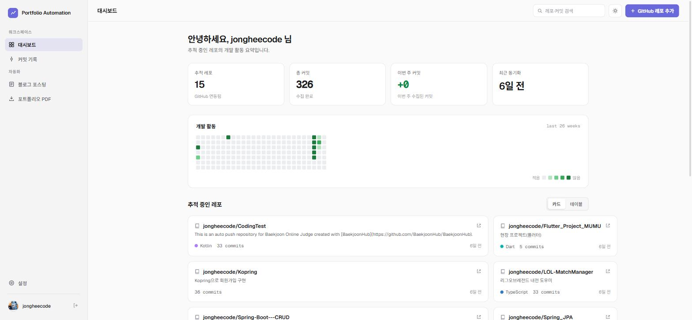
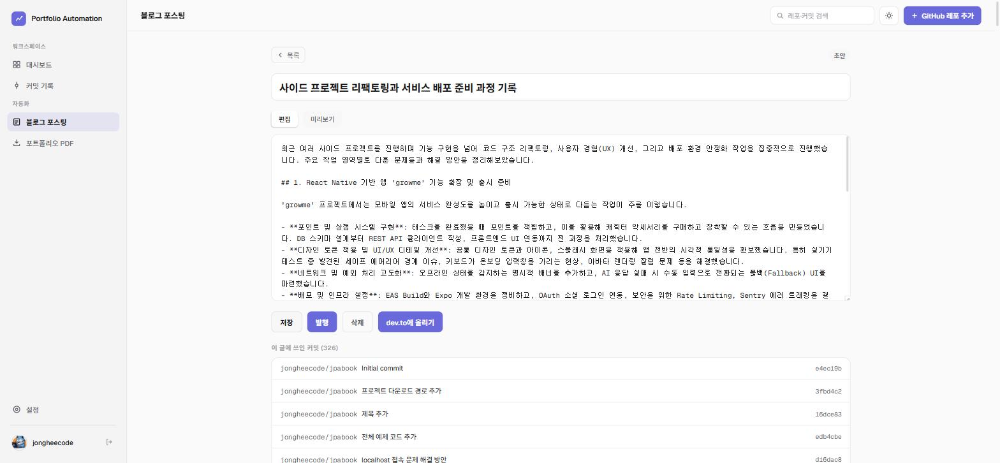
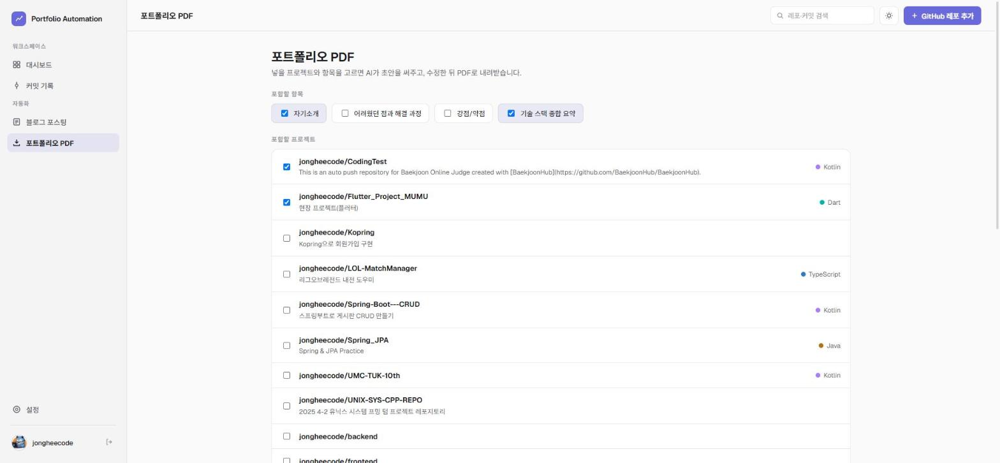
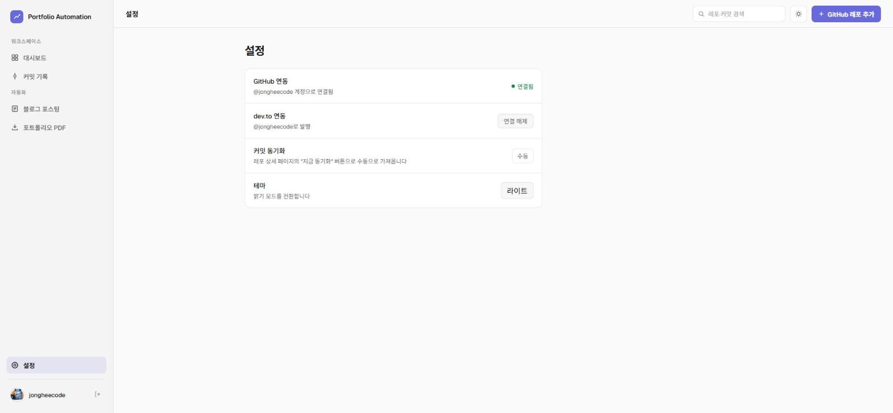
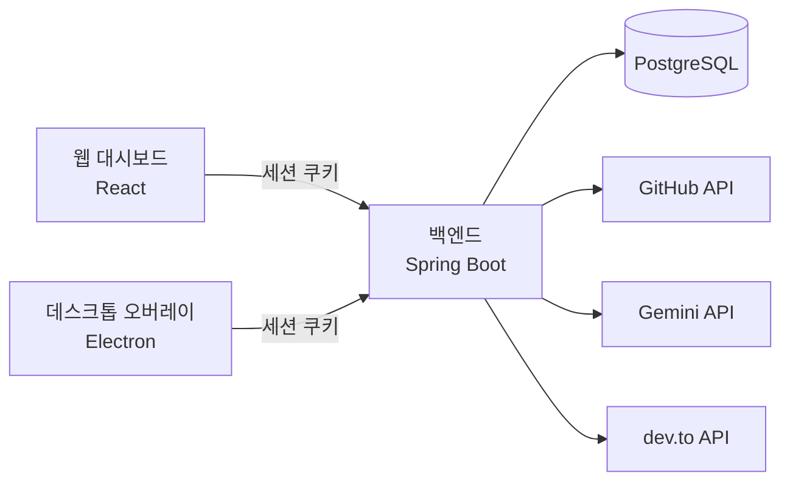

# Portfolio Automation

개발 기록을 남기는 게 항상 귀찮았다. 커밋은 쌓이는데 블로그는 안 쓰고, 포트폴리오는 취업/이직 시즌 되면 급하게 만들고. 그래서 GitHub 커밋만 있으면 나머지는 자동으로 되게 만들어봤다. 커밋을 모아서 기술 블로그 초안을 써주고, 레포를 골라서 포트폴리오 PDF도 뽑아준다.

혼자 쓰려고 만든 개인 프로젝트라 로그인은 GitHub 계정 하나로 끝난다.

| | |
|---|---|
| 기간 | 2026.07 ~ (계속 진행 중) |
| 인원 | 1명 (개인 프로젝트) |
| 역할 | 기획·백엔드·프론트엔드·데스크톱 앱 전부 |



## 뭘 할 수 있나

**GitHub 레포를 등록하면 커밋을 자동으로 모아준다.**

추적할 레포를 추가하면 그 레포의 커밋 기록을 가져와서 쌓아둔다. 대시보드에서 얼마나 커밋했는지, 어떤 레포를 얼마나 건드렸는지 한눈에 볼 수 있다.

**아직 블로그에 안 쓴 커밋을 모아서 초안을 써준다.**

"새 초안 생성"을 누르면 여태 글로 정리 안 한 커밋들을 모아서 AI(Gemini)가 무슨 작업을 했는지 정리한 초안을 써준다. 그대로 쓸 수도 있고 편집해서 다듬을 수도 있다. 다 됐으면 dev.to에 바로 올린다.

> AI 초안 생성은 지금 잠깐 쉬고 있다. 구글 쪽에서 Gemini API 접근을 막아놔서 복구될 때까지 보류 상태. 커밋 모으기·발행·PDF는 이거랑 상관없이 다 된다.



**레포 몇 개 골라서 포트폴리오 PDF도 뽑는다.**

포함하고 싶은 프로젝트와 넣고 싶은 항목(자기소개, 기술 스택 등)을 고르면 README랑 커밋 기록을 바탕으로 초안을 써준다. 편집하고 PDF로 다운로드하면 끝.



**설정은 계정 연동 두 개뿐.**

GitHub은 로그인할 때 이미 연동돼 있고, dev.to는 API 키 하나만 넣으면 연결된다. OAuth 앱 등록 같은 거 필요 없다.



**op.gg처럼 다른 창 위에 항상 떠 있는 데스크톱 위젯도 있다.**

웹 대시보드는 결국 안 켜보게 되길래, 아예 코딩하는 동안 화면 한쪽에 계속 떠 있는 작은 알약을 만들었다. 숫자 대신 "지금 가장 급한 일 한 줄"을 보여준다 — 코드에 보안/구조 패턴이 잡히면 그걸 먼저, 없으면 push 대기나 아직 블로그로 안 옮긴 커밋 같은 평소 백로그를 보여준다. 클릭하면 근거와 함께 지금 작업 중인 브랜치 상태가 뜨고, 전역 단축키로 더 큰 패널도 띄울 수 있다. Electron이라 별도 앱으로 뜨고, 로그인은 이 위젯만의 창으로 따로 한다.

## 어떻게 만들었나

- 백엔드: Kotlin + Spring Boot (GitHub OAuth 로그인, PostgreSQL)
- 웹 프론트: React + TypeScript + Vite
- 데스크톱 위젯: Electron + React + TypeScript
- 블로그/포트폴리오 초안: Google Gemini API (현재 접근 제한으로 보류)
- 블로그 발행: dev.to Open API
- 테스트: JUnit (커밋 메타·주간 집계·Git 로그 파싱·GitHub 활동 분류·발견 엔진 규칙/우선순위/서비스 단위 테스트)

## 어떻게 동작하나



웹 대시보드랑 데스크톱 오버레이가 같은 백엔드를 보고, 로그인도 둘 다 GitHub OAuth 세션 쿠키 하나로 처리한다. 커밋은 GitHub API에서, 글/포트폴리오 초안은 Gemini에서, 발행은 dev.to에서 가져오고 내보낸다.

### 커밋 동기화는 sha 기준으로 중복 없이 쌓는다

레포 하나를 등록하면 최근 90일치 커밋을 GitHub API로 훑는다. 이미 저장된 커밋(sha로 구분)은 다시 안 쌓고 머지 여부·작성자 깃허브 로그인 같은 메타데이터만 갱신하고, 없는 커밋만 새로 저장한다. 그래서 동기화 버튼을 몇 번을 눌러도 중복이 안 생긴다.

### Gemini 응답은 포맷을 안 지킬 수 있다고 전제하고 파싱한다

프롬프트에 "JSON만 줘"라고 못 박아도 모델이 ` ```json ` 코드펜스로 감싸거나 앞뒤에 설명을 붙일 때가 있다. 그래서 첫 `{`부터 마지막 `}`까지만 잘라내는 파싱이랑 코드펜스 제거를 따로 둬서, 모델이 지시를 완벽히 안 지켜도 깨지지 않게 했다.

### PDF 한글은 OS 폰트를 직접 가져다 쓴다

PDF 렌더러(openhtmltopdf) 기본 폰트에는 한글 글리프가 없어서 그냥 쓰면 다 깨진다. 지금은 로컬 Windows에 있는 맑은 고딕을 경로로 지정해서 로드하는 식으로 해결했다. `pdf.font-path` 설정값이라 다른 폰트 파일 경로로 바꿀 수 있다. 다만 맑은 고딕 자체는 윈도우에 딸려오는 폰트라 재배포 라이선스가 없어서 레포에는 못 넣는다. 다른 OS나 서버에 올릴 땐 Noto Sans KR 같은 배포 가능한 한글 폰트를 받아서 `pdf.font-path`를 그쪽으로 돌려줘야 하고, 안 하면 경고 로그만 남고 한글은 그대로 깨진다.

## 지금 작업 중

발견 엔진(위 알약 문구를 고르는 휴리스틱)은 다 돼서 main에 들어갔다. 커밋 습관(메시지가 너무 짧다거나, 테스트 없이 커밋했다거나)을 모아 보여주는 주간 리뷰 페이지(`/week-review`)도 같이 붙었다. 지금은 큰 기능 추가 없이 코드 읽다가 눈에 걸리는 작은 것들 — 죽은 코드, 범위가 안 맞는 휴리스틱, 오래된 문서 — 을 하나씩 찾아서 고치는 중이다.

## 로컬에서 돌려보기

### 1. GitHub OAuth App 등록

https://github.com/settings/developers 에서 OAuth App 하나 만든다.
- Homepage URL: `http://localhost:5173`
- Authorization callback URL: `http://localhost:8080/login/oauth2/code/github`

### 2. Gemini API 키 발급

https://ai.google.dev (Google AI Studio) 에서 무료로 발급받으면 된다.

### 3. DB 띄우기

```
docker compose up -d
```

### 4. 백엔드 실행

`backend/.env.local`(gitignore됨)에 아래 값을 채워넣고:

```
GITHUB_CLIENT_ID=...
GITHUB_CLIENT_SECRET=...
GEMINI_API_KEY=...
```

```
cd backend
set -a && . ./.env.local && set +a && ./gradlew bootRun
```

기본 포트는 8080.

### 5. 프론트 실행

```
cd frontend
npm install
npm run dev
```

기본 포트는 5173. `.env.example` 참고해서 API 주소를 바꿀 수 있다(기본값 `http://localhost:8080`).

### 6. 써보기

`http://localhost:5173`에서 GitHub로 로그인 → 추적할 레포 등록 → 동기화 → 블로그/PDF 페이지에서 초안 생성.

dev.to 발행은 계정 설정(Settings → Extensions → DEV Community API Keys)에서 API 키를 발급받아 앱 설정 페이지에 붙여넣으면 된다.

### 7. 데스크톱 위젯 (선택)

```
cd desktop
npm install
npm run dev
```

백엔드가 떠 있어야 하고, 처음 뜨면 알약을 눌러서 따로 로그인 한 번 해줘야 한다.

## 폴더 구조

```
backend/   # Kotlin + Spring Boot API 서버
frontend/  # 웹 대시보드 (React + Vite)
desktop/   # 데스크톱 오버레이 위젯 (Electron + React)
docs/      # 설계 문서, 스크린샷, 디자인 스크래치 파일
```
